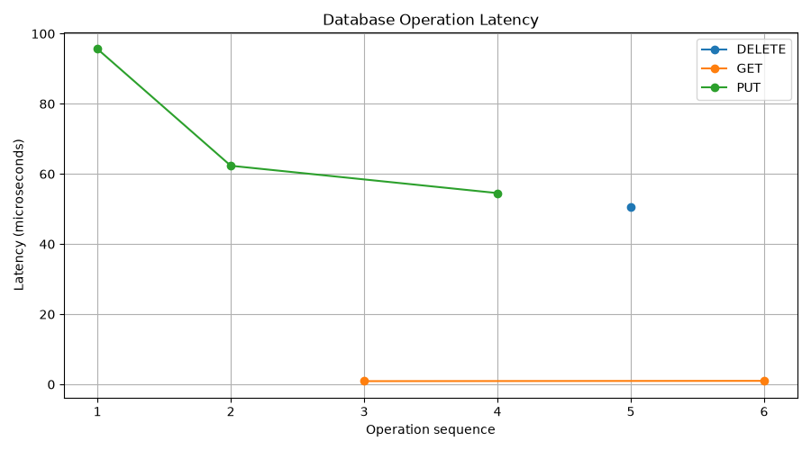
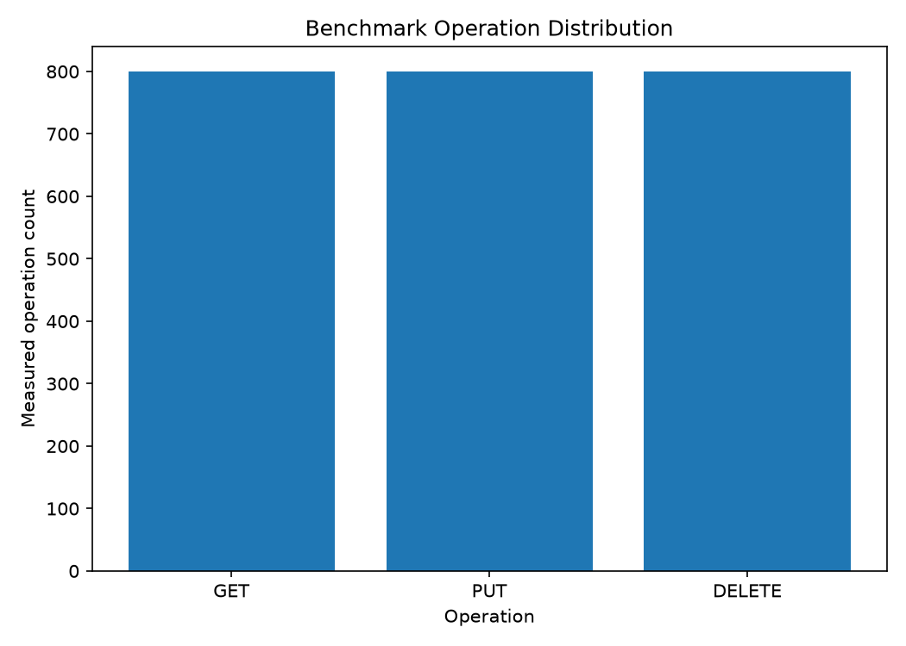
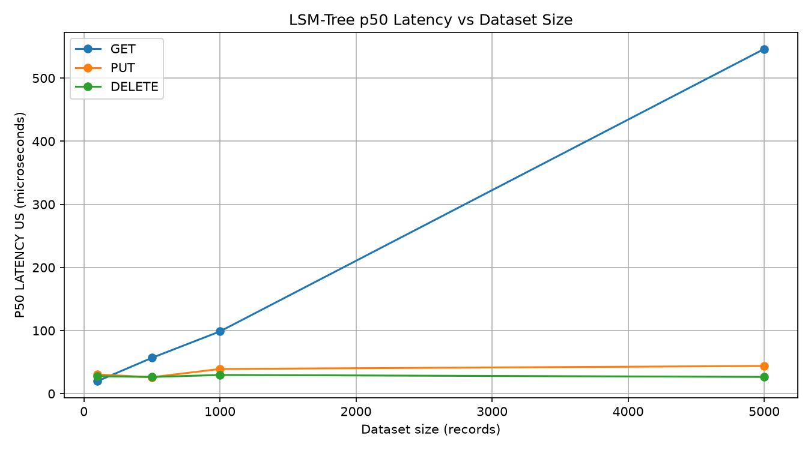
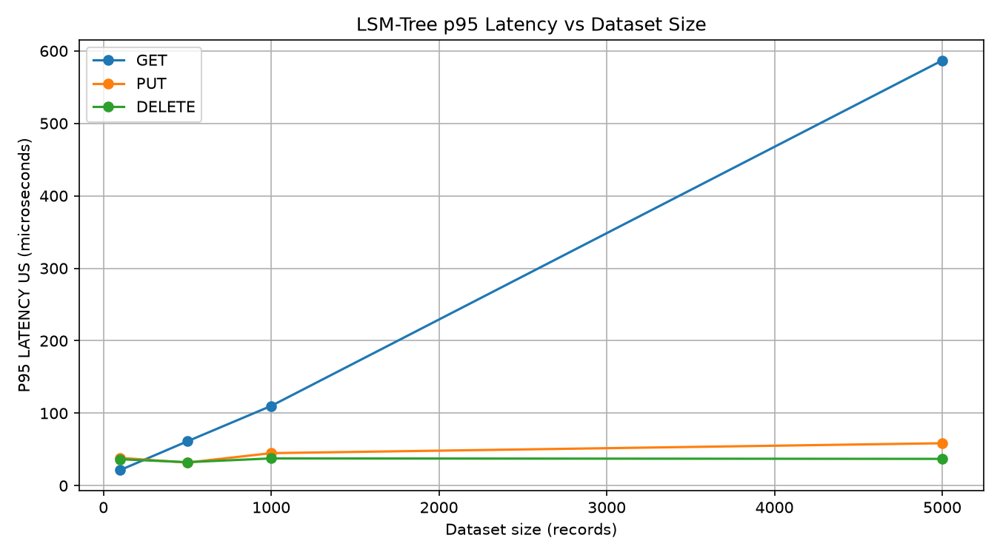
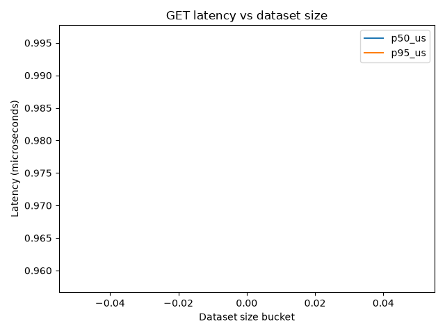
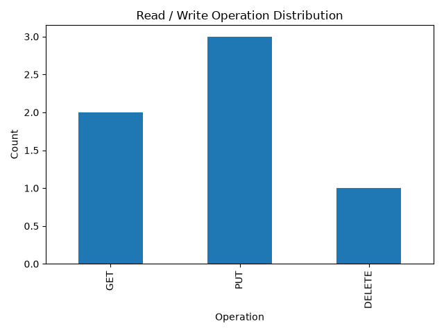

# CUSTOM DATABASE STORAGE SYSTEM USING LSM-TREE

## 1. Abstract

This project presents a learning-scale key-value storage system based
on the Log-Structured Merge Tree (LSM-Tree) architecture. The system
is implemented in Python and demonstrates basic database storage
operations including PUT, GET and DELETE.

The system uses a Write-Ahead Log (WAL) to record operations,
an in-memory Memtable to hold recent updates, and SSTable files to
store flushed data. It also implements data recovery and basic
compaction.

Automated testing is performed to verify implemented features.
Performance experiments measure GET, PUT and DELETE latency at
multiple dataset sizes. The experiment collects average, P50 and
P95 latency values.

## 2. Introduction

Databases are important components of modern applications. They store,
retrieve, update and delete information efficiently.

A storage engine determines how data is organized and how operations
are performed internally. LSM-Tree is a storage architecture designed
to organize write operations efficiently by using memory structures
and sequential disk storage.

This project implements a simplified LSM-Tree to understand database
storage internals.

## 3. Problem Statement

Frequent random disk updates can be costly for storage systems.
The project explores an alternative approach where updates are first
recorded in a log and buffered in memory, before being written into
sorted storage files.

The goal is to build a simplified storage engine that demonstrates
this approach.

## 4. Objectives

- Build a key-value database in Python.
- Implement PUT, GET and DELETE.
- Implement WAL-based logging.
- Use an in-memory Memtable.
- Store flushed data in SSTable files.
- Recover operations after restarting.
- Implement flushing and compaction.
- Test database correctness.
- Measure operation latency.

## 5. Existing System

A simple storage approach may directly modify data on disk for each
operation. Frequent random updates can create additional disk work.

Traditional approaches may also require mechanisms for recovery and
maintaining consistency after unexpected termination.

## 6. Proposed System

The proposed system uses a simplified LSM-Tree architecture.

Updates are recorded in a WAL and applied to the Memtable. When the
Memtable reaches its configured threshold, its entries are written
into an SSTable.

The database searches recent in-memory changes before older disk
files. Compaction merges SSTables and removes obsolete deleted
entries.

## 7. System Architecture

The system consists of these components:

1. Client interface
2. PUT, GET and DELETE operations
3. Write-Ahead Log
4. Memtable
5. SSTable storage
6. Flush mechanism
7. Recovery mechanism
8. Compaction

Operation flow:

Client
  |
PUT / DELETE
  |
WAL
  |
Memtable
  |
Flush
  |
SSTable

GET checks the Memtable first and then searches SSTables in
newest-to-oldest order.

## 8. LSM-Tree Explanation

An LSM-Tree is a storage structure that organizes data through
memory buffering and disk-based sorted files.

### Memtable

The Memtable is an in-memory data structure that stores recent
changes. Reads check it before searching disk storage.

### WAL

The Write-Ahead Log records changes before the database applies
them to its in-memory state. It helps recover operations after
restarting.

### SSTable

A Sorted String Table is a disk-based file containing stored entries
in sorted key order.

### Flush

Flush writes Memtable contents to a new SSTable. This allows
memory data to be persisted into disk files.

### Compaction

Compaction merges existing SSTables, removes obsolete versions
and removes deleted entries when safe within the implementation.

## 9. Implementation

The project is implemented using Python.

The main storage engine is defined in `lsm_store.py`.

Implemented components include:

- WAL append
- PUT
- GET
- DELETE
- Memtable
- SSTable files
- Flush
- Recovery
- Compaction

Data is stored using JSON-based files for learning and
demonstration purposes.

## 10. Testing

Automated tests are written using Python's unittest framework.

The tests are executed using:

python test_lsm.py

The test suite reported 8 tests passing.

Testing covers the behaviors implemented in the test suite,
including storage operations, persistence, recovery,
truncated WAL handling, flushing, SSTable behavior and compaction.

## 11. Performance Evaluation

The performance benchmark evaluates four dataset sizes:

- 100 records
- 500 records
- 1,000 records
- 5,000 records

For each dataset size, the benchmark measures GET, PUT and DELETE.

Each operation has 200 timed samples per dataset size.

The measurements are recorded in microseconds.

The following metrics are calculated:

- Average latency
- P50 latency
- P95 latency

Benchmark execution:

python run_benchmark.py

The detailed measurements are saved to benchmark_raw.csv.

The summarized measurements are saved to benchmark_results.csv.

## 12. Results

| Dataset Size | Operation | Average (μs) | P50 (μs) | P95 (μs) |
|---:|---|---:|---:|---:|
| 100 | GET | 20.653 | 19.875 | 21.500 |
| 100 | PUT | 31.474 | 30.459 | 38.334 |
| 100 | DELETE | 29.222 | 27.667 | 36.459 |
| 500 | GET | 57.319 | 56.750 | 61.167 |
| 500 | PUT | 27.647 | 26.105 | 31.834 |
| 500 | DELETE | 27.725 | 26.500 | 32.417 |
| 1000 | GET | 100.658 | 98.625 | 110.042 |
| 1000 | PUT | 37.671 | 39.146 | 44.875 |
| 1000 | DELETE | 30.029 | 29.666 | 37.583 |
| 5000 | GET | 583.018 | 546.062 | 586.834 |
| 5000 | PUT | 45.980 | 43.916 | 58.542 |
| 5000 | DELETE | 28.162 | 26.563 | 36.958 |

### Graphs

### Latency by Sequence

The following graphs visualize the benchmark results and operation performance of the LSM-Tree storage system.

#### 1. Benchmark Operation Distribution

#### 2. Latency by Sequence

#### 3. P50 Latency vs Dataset Size

#### 4. P95 Latency vs Dataset Size

#### 5. Latency vs Dataset Size

#### 6. Operation Distribution

#### P50 Latency

#### P95 Latency

The measured graphs show how latency changes across dataset sizes in this particular implementation and benchmark environment.

## 13. Advantages

- Simple implementation for learning.
- Demonstrates database storage internals.
- Supports key-value operations.
- WAL-based recovery.
- Memtable and SSTable organization.
- Flush and compaction.
- Automated tests.
- Performance measurement.

## 14. Limitations

- Uses JSON files rather than optimized binary storage.
- GET loads SSTable contents during searches.
- No Bloom filter.
- No advanced index structure.
- Limited concurrency.
- Simplified compaction.
- Not designed for production-scale workloads.

## 15. Future Scope

- Implement Bloom filters.
- Implement SSTable indexes.
- Improve read performance.
- Add background compaction.
- Add concurrency and locking.
- Improve crash recovery.
- Add a command-line interface.
- Explore larger datasets and varied workloads.

## 16. Conclusion

The project demonstrates the basic concepts of an LSM-Tree storage
engine using Python.

It implements a key-value storage model with WAL, Memtable,
SSTable, flush, recovery and compaction.

The tests and benchmark provide a practical way to study correctness
and performance characteristics.

The project helped develop an understanding of database storage
structures, data recovery, performance measurement and software
testing.

## 17. References

1. SQLite documentation — https://www.sqlite.org/docs.html
2. Python documentation — https://docs.python.org/3/
3. Python unittest documentation — https://docs.python.org/3/library/unittest.html
4. Matplotlib documentation — https://matplotlib.org/stable/
5. RocksDB documentation — https://rocksdb.org/
6. LevelDB project — https://github.com/google/leveldb
7. LSM-Tree database storage concepts and course materials.
