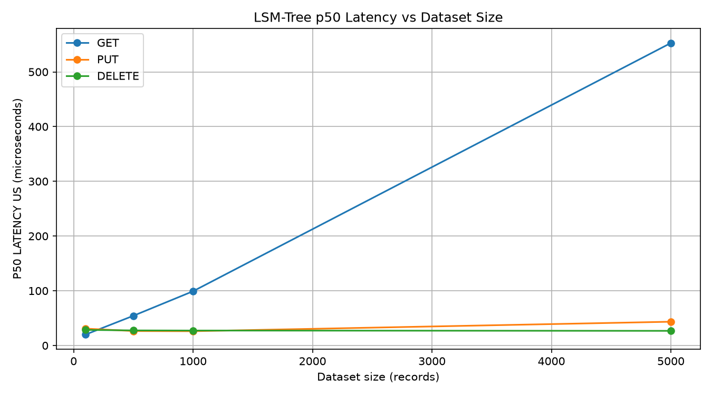
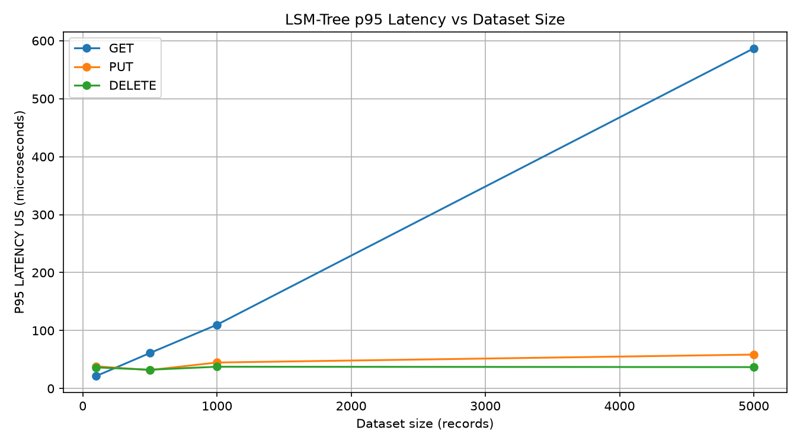
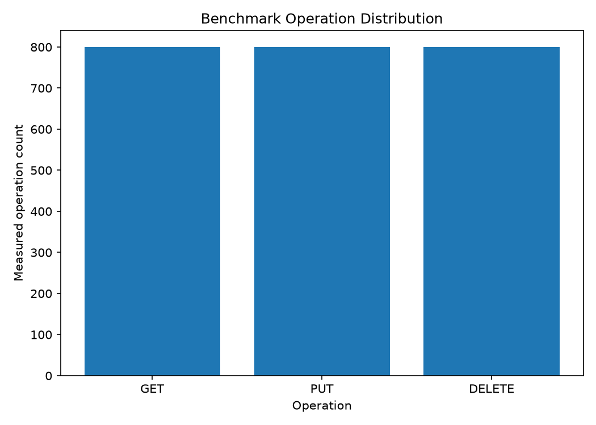

# Custom Database Storage System — LSM-Tree

## Introduction

This project implements a learning-scale key-value database storage engine
using the Log-Structured Merge Tree (LSM-Tree) design.

It demonstrates how a database can manage data through an in-memory
Memtable, a Write-Ahead Log (WAL), Sorted String Table (SSTable)
files, flushing and compaction.

## Problem Statement

Traditional storage systems may experience expensive random disk writes
when data is frequently updated. LSM-Tree designs organize writes
through sequential logging and memory buffering, followed by sorted
disk storage.

This project explores these concepts through a simple Python implementation.

## Objectives

- Implement a key-value storage system.
- Support PUT, GET and DELETE operations.
- Implement Write-Ahead Logging.
- Maintain an in-memory Memtable.
- Flush Memtable data into SSTable files.
- Recover data from the WAL after restart.
- Implement basic compaction.
- Test correctness and evaluate operation latency.

## Features

- PUT: insert or update a key.
- GET: retrieve a key's value.
- DELETE: delete a key using a tombstone.
- WAL: records changes for recovery.
- Memtable: stores recent changes in memory.
- SSTables: stores flushed entries in JSON files.
- Flush: writes Memtable contents into an SSTable.
- Recovery: restores unflushed operations from the WAL.
- Compaction: merges SSTables and removes deleted entries.
- Automated tests.
- Performance benchmarking and graphs.

## Technologies Used

- Python
- JSON
- CSV
- Matplotlib
- unittest
- Git
- GitHub
- Visual Studio Code

## Architecture

Client operations
       |
       v
 PUT / GET / DELETE
       |
       v
 Write-Ahead Log (WАL)
       |
       v
    Memtable
       |
       | Flush
       v
   SSTable files
       |
       | Compaction
       v
 Merged SSTable

GET searches the Memtable first, then SSTables from newest to oldest.

## Project Structure

```text
.
├── data/
├── plots/
├── workload_data/
├── analyze.py
├── lsm_store.py
├── main.py
├── plot_latency.py
├── run_benchmark.py
├── run_workload.py
├── test_lsm.py
├── workload.csv
├── results.csv
├── benchmark_results.csv
├── benchmark_raw.csv
├── requirements.txt
└── README.md
```

## Installation

Clone the repository:

```bash
git clone https://github.com/Aarya918/Custom-database-storage-system-.git
cd Custom-database-storage-system-
```

Create a virtual environment:

```bash
python3 -m venv .venv
```

Activate it:

```bash
source .venv/bin/activate
```

Install dependencies:

```bash
pip install -r requirements.txt
```

## Running the Database

Run:

```bash
python main.py
```

Use the application's available interface to perform key-value operations.

## Running Tests

Run:

```bash
python test_lsm.py
```

The test suite checks implemented database behavior.

## Performance Benchmark

Run:

```bash
python run_benchmark.py
```

The benchmark evaluates dataset sizes:

- 100 records
- 500 records
- 1,000 records
- 5,000 records

Each dataset size uses 200 samples per operation type:
GET, PUT and DELETE.

The benchmark saves summary measurements to:

- `benchmark_results.csv`

Individual measurements are saved to:

- `benchmark_raw.csv`

## Performance Metrics

- Average latency
- P50 latency (median)
- P95 latency (95th percentile)

Latency is recorded in microseconds.

## Graphs

### P50 latency



### P95 latency



### Benchmark operation distribution



## Results

Measured results are stored in `benchmark_results.csv`.

The graphs visualize the measured latency of GET, PUT and DELETE
operations across different dataset sizes.

Performance values depend on the machine, dataset, implementation,
and benchmark environment.

## Limitations

- SSTables use JSON files rather than a binary storage format.
- GET may load and parse an entire SSTable during lookup.
- No Bloom filters.
- No block index.
- Limited concurrency support.
- No advanced crash-safe manifest.
- Basic compaction implementation.

## Future Scope

- Implement Bloom filters.
- Add SSTable indexes.
- Improve lookup performance.
- Add background compaction.
- Support concurrent operations.
- Add a command-line interface.
- Improve crash recovery and storage metadata.
- Evaluate more workload types.

## Conclusion

This project demonstrates the fundamental components of an LSM-Tree
storage engine: WAL, Memtable, SSTables, flushing, recovery and
compaction.

It provides a foundation for understanding database storage internals
and evaluating basic performance characteristics.


